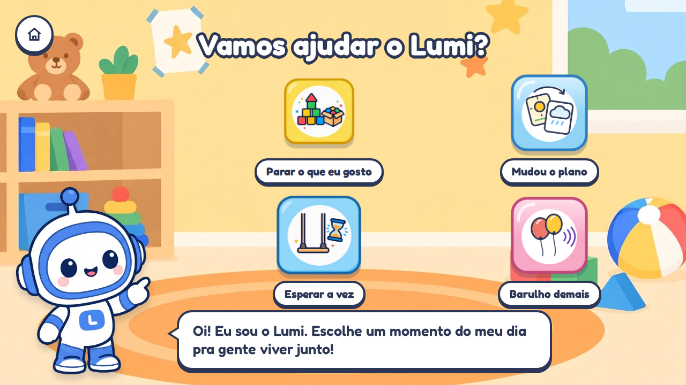
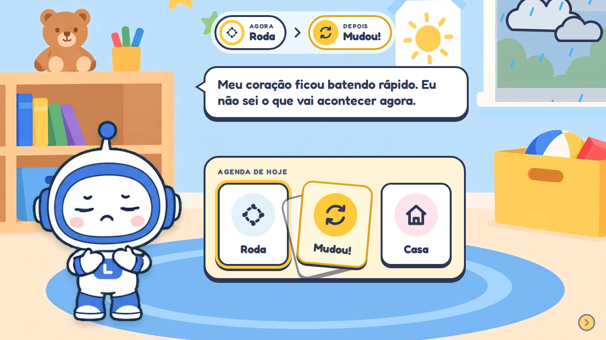
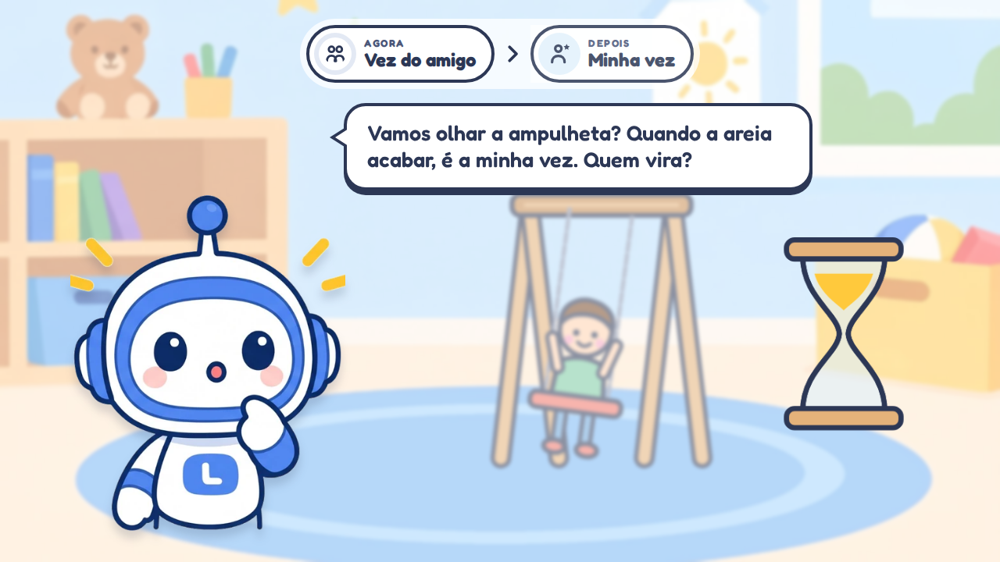
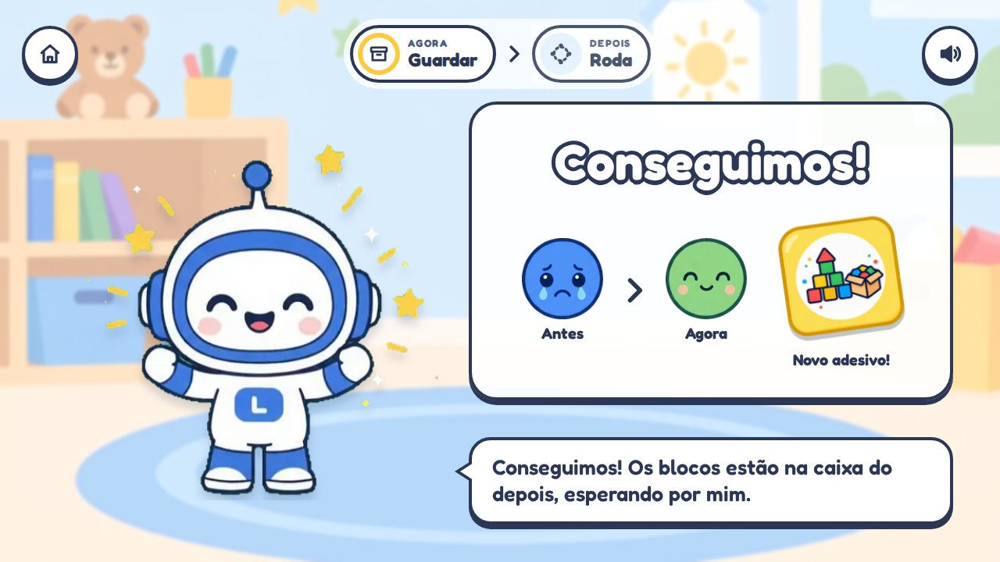
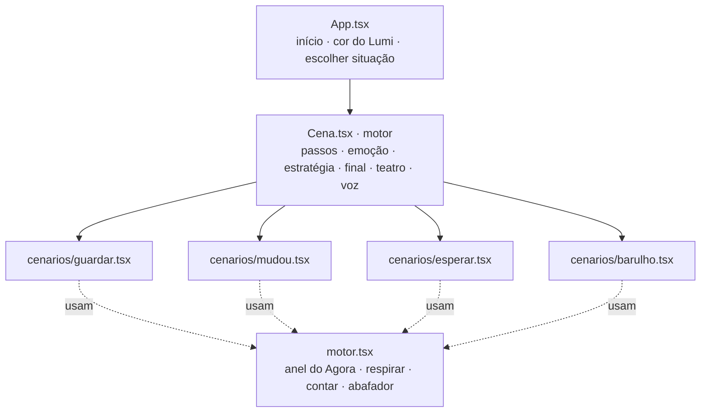

<h1 align="center">🤖 Lumi e as Emoções</h1>

<p align="center">
  <b>Jogo educativo para ensaiar as transições da rotina escolar com crianças de 3 a 6 anos, incluindo crianças com TEA e TDAH.</b>
</p>

<p align="center">
  
  
  
  
  
  
</p>

<p align="center">
  
</p>

---

## 📌 O que é

O **Lumi** é um jogo para a Educação Infantil. A criança vive, junto com um robozinho, um momento difícil da rotina, como parar de brincar, ver o plano mudar, esperar a vez ou aguentar barulho demais, e ensaia com segurança o que fazer quando esse momento chegar na vida real.

Ele nasceu de uma observação das professoras entrevistadas: a crise da criança quase nunca vem da atividade em si. Ela vem do **momento em que a atividade acaba e a criança é pega de surpresa**. O Lumi ensaia exatamente esse momento, sempre na mesma sequência:

```
vai acabar  →  o que eu sinto no corpo  →  que nome tem  →  o que eu faço  →  acabou, e ficou tudo bem
```

Frase-guia do projeto: **uma atividade pode terminar sem que isso seja algo ruim.**

O jogo funciona de dois jeitos:

- **Com uma criança**, no notebook ou tablet: ela toca nas coisas e o Lumi responde.
- **Com a turma toda (modo teatro)**: a professora projeta a cena e conduz a história pelo teclado ou por um passador de slides. Nada avança sozinho.

```mermaid
flowchart LR
    A[Brincar junto<br/>anel do Agora enche] --> B[Aviso leve<br/>'daqui a pouquinho']
    B --> C[Sinal<br/>visual + sino]
    C --> D[Lumi diz o que<br/>sente no corpo]
    D --> E[Criança escolhe<br/>a carinha]
    E --> F[Criança escolhe<br/>a estratégia]
    F --> G[Fazem juntos]
    G --> H[Transição<br/>acontece]
    H --> I[Conseguimos!<br/>antes → agora + adesivo]
    I --> J[E você?<br/>conversa com o adulto]
```



## ✨ Destaques

- **Sem caminho de erro**: toda carinha e toda estratégia são aceitas. O Lumi acolhe a resposta e diz o que **ele** sente (RF10, R-IHC09).
- **Primeiro o corpo, depois o nome**: antes de pedir a emoção, o Lumi conta o que sente ("minha barriga ficou apertada", "meus ouvidos estão doendo"). Muitas crianças autistas e as menores ainda não reconhecem a emoção pelo nome.
- **O sentimento diminui, não some**: o Lumi termina com "ainda tô um pouquinho triste, mas agora eu consigo". A criança aprende que dá para fazer a transição sentindo alguma coisa.
- **Aviso antes, sinal depois**: o fim nunca chega de surpresa. Em todo cenário, o anel do **Agora** enche e vem um "daqui a pouquinho" antes do sinal.
- **Retorno imediato**: todo toque responde na hora com som e movimento, e toda fala aparece também em balão, como legenda para o adulto.
- **Poucos elementos por tela**: são 3 carinhas e 3 estratégias por cenário, com linguagem literal e sem metáforas.
- **Modo teatro**: a professora conduz a cena para a turma com uma tecla só.
- **Offline e sem cadastro**: não tem backend nem login. Cor do Lumi e adesivos ficam no `localStorage`.

## 🎭 Os 4 cenários

Os cenários foram desenhados pensando em uma sala real, com crianças com TEA, com TDAH e com desenvolvimento típico juntas. Cada um trabalha a dificuldade que mais gera crise para um desses grupos.

| Cenário | Agora → Depois | Para quem pesa mais | O que a criança faz junto com o Lumi |
| --- | --- | --- | --- |
| 🧱 **Parar o que eu gosto** | Brincar → Roda | hiperfoco (TEA, TDAH) | respirar no balão · contar até 5 · dar tchau para cada bloco, que vai para a *caixa do depois* |
| 🌧️ **Mudou o plano** | Roda → ~~Parque~~ → Massinha | previsibilidade (TEA) | tocar no cartão **Mudou!** da agenda · escolher outra brincadeira · respirar |
| ⏳ **Esperar a vez** | Vez do amigo → Minha vez | controle do impulso (TDAH) | virar a ampulheta e ver a areia cair · apertar as mãos e contar · cantar baixinho |
| 🎈 **Barulho demais** | Festa → Parabéns → Cantinho → Festa | sensorial (TEA) | pôr o abafador · mostrar o cartão de pausa · ir para o cantinho calmo |

Cada cenário tem pelo menos uma estratégia **de corpo** (respirar, apertar as mãos), que ajuda muito no TDAH, e uma **de pedir** (cartão de pausa, olhar a agenda), que ensina comunicação funcional, o que substitui a crise no TEA.

<p align="center">
  
  
  <br>
  
</p>

A justificativa de cada escolha, com o material para usar na sala e os cuidados, está em [docs/CENARIOS.md](docs/CENARIOS.md).

## 🎬 Modo teatro

Abra **`/?teatro`**. O Lumi passa a falar com "vocês" e a cena espera a professora a cada passo. O modo só entra pelo link, para que uma criança não caia nele sem querer e fique esperando.

| Tecla | O que faz |
| --- | --- |
| `Espaço` `→` `PageDown` `Enter` | avança: enche o anel, segue a história ou toca no que está piscando (balão, cartão, ampulheta, nota, balanço…) |
| `←` `PageUp` `R` | repete a última fala |
| `1` `2` `3` | registra a carinha ou a estratégia que a turma escolheu |
| `V` | liga/desliga a voz (sem voz, a professora faz o Lumi e lê o balão) |
| `Esc` | volta ao início |

A setinha amarela no canto inferior direito avisa que a cena está parada, esperando a professora. O toque continua funcionando, então uma criança pode ir até o notebook e virar a ampulheta ela mesma.

## 🧩 Como o código se organiza

Toda cena segue os mesmos passos. Quem cuida deles é um motor comum, e cada cenário só descreve o próprio palco.



Passos de uma cena: `abertura → sinal → emocao → estrategia → fazer → transicao → conseguimos`.

O motor desenha as telas de emoção, estratégia e final. Cada cenário exporta seus dados (carinhas, estratégias, falas finais) e um `Palco` com o cenário, os objetos tocáveis e as falas de cada passo. Para criar um 5º cenário, basta um arquivo novo em `cenarios/` e uma linha em `cenarios/index.ts`.

```
web/src/
├── app/                  # página Next (o jogo é Client Component, sem SSR)
└── jogo/
    ├── App.tsx           # telas de início, cor e escolha
    ├── Cena.tsx          # motor da cena + modo teatro
    ├── motor.tsx         # peças comuns entre cenários
    ├── cenarios/         # um arquivo por cenário
    ├── ui.tsx            # Lumi, balão, barra Agora → Depois, ícones
    └── som.ts            # voz (speechSynthesis) e efeitos (WebAudio)
```

## 🏗️ Stack

| Camada | Tecnologia |
| --- | --- |
| App | Next.js 16 (App Router) + React 19 |
| Linguagem | TypeScript |
| Palco | 1280×720 fixo, escalado para a tela |
| Voz | `speechSynthesis` em pt-BR (voz do sistema) |
| Sons | WebAudio gerado em código: sino, toque, chuva, notas. Volume baixo de propósito. |
| Progresso | `localStorage` (cor do Lumi e adesivos) |
| Arte | Lumi e cenários da equipe. Props novos em SVG desenhados no Doop. `tools/assets.py` converte a pasta do Drive para `web/public/` |

## 🚀 Como rodar

**Pré-requisito:** Node.js 20 ou mais novo.

```bash
git clone https://github.com/luis-hm/Lumi.git
cd Lumi/web

npm install
npm run build && npm start   # http://localhost:3000
```

Na apresentação, use `npm start` e aperte **F11** para a tela cheia. Para desenvolver, use `npm run dev`.

| Link | Para quê |
| --- | --- |
| `http://localhost:3000` | criança jogando sozinha (ou com um adulto do lado) |
| `http://localhost:3000/?teatro` | professora conduzindo a turma |

> A voz depende do navegador. No Chrome e no Edge, a voz pt-BR já vem instalada.

## 📚 Documentação

- [docs/ARQUITETURA.md](docs/ARQUITETURA.md): fluxo, passos, regras de interação e stack.
- [docs/CENARIOS.md](docs/CENARIOS.md): revisão psicopedagógica dos cenários para TEA e TDAH.

---

<p align="center">
  Projeto da disciplina de <b>Interação Humano-Computador</b> · UFC Campus Russas
</p>
